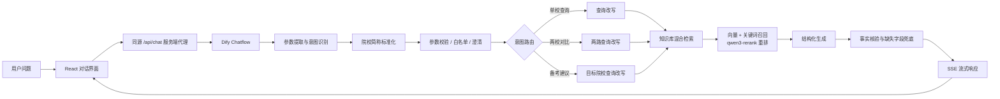
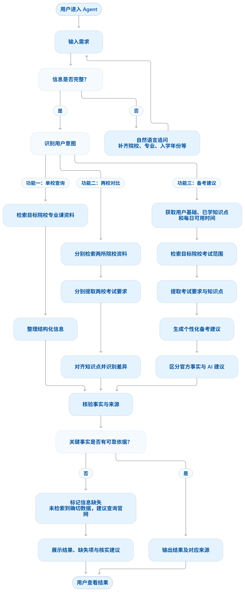

# EE ExamScope Agent｜电子通信考研专业课匹配与院校对比助手

面向电子信息、通信工程等相关专业考研学生的 AI Agent MVP。它把分散的专业课科目、考试范围、参考书目与招生信息整理为可查询、可比较的结构化结果，并结合用户基础生成备考启动建议。

> 当前状态：本地可运行；Dify Workflow 可导入；前端生产构建与 6 项自动化测试通过。在线 Demo 将采用按需开放方式，避免无上限消耗模型 API 额度。

## 在线材料

- [Figma 可交互原型](https://www.figma.com/design/74FCEyeKJkl33GOlxIrYe2/Agent?node-id=3-2)
- [演示视频脚本](docs/demo-script.md)
- 演示视频：制作中
- 在线 Demo：按需开放，部署完成后补充

## 产品定位

### 目标用户

正在进行电子信息、通信工程等方向考研择校与专业课准备的学生。

### 核心痛点

1. 院校专业课信息分散在招生目录、考试大纲、参考书目和学院通知中，查找成本高。
2. 不同院校科目名称、知识点表达和教材口径不一致，难以直接比较。
3. 用户知道目标院校后，仍难把考试范围转化为符合自身基础的学习顺序。

### MVP 功能

1. **单校查询**：查询目标院校、专业和拟入学年份对应的专业课、科目代码、考试范围与参考书目。
2. **两校对比**：对齐两所院校的共同知识点、独有知识点、科目及教材差异。
3. **个性化备考建议**：结合目标院校考试范围、用户基础、已学知识点和每日可投入时间，生成 4 周启动建议。

## 系统架构



产品主流程图：



## AI 工作流设计

### 1. 用户问题理解

- 参数提取：院校、专业或方向、拟入学年份、当前基础、每日可投入时间、已学知识点。
- 意图分类：`single_query`、`compare`、`study_plan`、`unknown`。
- 多轮补全：信息不足时只追问缺失字段，不要求用户重复全部问题。
- 院校别名标准化：例如“北理工”映射为“北京理工大学”。

### 2. RAG 检索链路

```text
用户提问
→ 参数抽取与查询改写
→ 知识库文档切片
→ 关键词检索（权重 0.3）+ 向量检索（权重 0.7）
→ Top-K 召回
→ qwen3-rerank 重排
→ LLM 按字段生成
→ 缺失信息与来源边界提示
```

### 3. 防幻觉规则

以下字段只能在知识库检索结果明确出现时输出：

- 分数线
- 招生人数
- 初试科目代码
- 参考书目

没有确切证据时统一回答：

> 未检索到确切数据，建议查询官网。

同时区分“知识库事实”和“AI 备考建议”，不把学习顺序、时间分配等模型推断包装成院校官方要求。

## 三类典型问题

### 单校查询

```text
北理工的电子信息专业课 2027 年考什么？
```

预期行为：识别“北理工”别名，检索北京理工大学 2027 年记录，按科目或考试模块输出科目代码、范围与参考书目。

### 两校对比

```text
对比武汉大学和浙江大学 2026 年电子信息专业课考试范围。
```

预期行为：分别检索两所院校，语义对齐共同知识点，列出各校独有内容、教材差异和缺失字段。

### 信息缺失兜底

```text
北京理工大学 2027 年电子信息复试分数线是多少？
```

预期行为：专业课信息不因分数线缺失而被整体判空；对于尚无确切记录的分数线，只输出缺失提示，不使用其他年份替代。

## 本地启动

### 环境要求

- Node.js 20.19 或更高版本
- 一个已发布的 Dify Chatflow 应用
- Dify App API Key

### 1. 安装依赖

```bash
npm install
```

### 2. 配置服务端环境变量

复制 `.env.example` 为 `.env.local`：

```env
DIFY_API_KEY=app-your-dify-api-key
```

密钥只由本地开发代理或 Vercel Serverless Function 读取。不要使用 `VITE_` 前缀，也不要把 `.env.local` 提交到 Git。

### 3. 导入 Dify Workflow

1. 在 Dify 中创建或进入工作区。
2. 导入 [`dify/EE_Communications ExamScope Agent.yml`](dify/EE_Communications%20ExamScope%20Agent.yml)。
3. 按导入提示重新选择可用的 LLM、Embedding 和 Rerank 模型。
4. 新建知识库并上传 [`knowledge-base`](knowledge-base) 中的 Markdown 样例。
5. 将工作流内的知识检索节点重新绑定到你的知识库。
6. 发布 Chatflow，复制应用 API Key 到 `.env.local`。

> Dify 导出的 DSL 会保留原工作区的数据集标识。换工作区导入后，必须重新绑定知识库，否则检索结果可能为空。

### 4. 启动开发环境

```bash
npm run dev
```

打开终端显示的本地地址，通常为 `http://localhost:5173`。

### 5. 测试与构建

```bash
npm test
npm run build
```

## 当前测试结果

验证日期：2026-11-08。

| 检查项 | 结果 |
|---|---:|
| 服务端缺少 API Key 时拒绝请求 | 通过 |
| 空问题拦截 | 通过 |
| 超过 4000 字的问题拦截 | 通过 |
| Dify SSE 事件解析 | 通过 |
| SSE 跨数据块拼接 | 通过 |
| 注释事件与 `[DONE]` 忽略 | 通过 |
| 自动化测试合计 | **6/6 通过** |
| Vite 生产构建 | **通过** |

Agent 效果评测尚未用统一测试集重新跑完，因此当前不声明问答准确率、召回率或幻觉率。计划从以下维度建立可复现评测：

- 意图识别准确率
- 必填参数提取准确率
- 检索命中率
- 关键字段正确率
- 无依据事实生成率
- 缺参澄清与越界拦截成功率

## 已知边界

1. 当前知识库只覆盖北京理工大学、大连理工大学、武汉大学、浙江大学的 2026/2027 样例数据。
2. MVP 暂不区分全日制与非全日制，也不覆盖全部学院和专业方向。
3. 部分官方材料的原始在线链接未保留，仓库样例只能作为工作流演示数据，不能替代院校官网核验。
4. 不支持的院校会被白名单拦截；系统不会用模型记忆补充知识库外的招生事实。
5. 不同年份的记录不会互相替代；跨年份、跨专业名称的比较仍需要更多结构化数据验证。
6. 模型输出具有概率性。当前项目通过结构化提示词与缺失字段兜底降低风险，但尚未建立生产级监控和人工复核后台。
7. Web 端目前没有用户登录、频率限制和每日预算熔断，不适合无限期公开提供模型调用。

## 仓库结构

```text
.
├─ api/                    # Vercel Serverless Function
├─ server/                 # Dify Streaming API 代理
├─ src/                    # React 前端
├─ tests/                  # Node 自动化测试
├─ dify/                   # 可导入的 Dify DSL
├─ knowledge-base/         # MVP 知识库样例
├─ docs/                   # 架构与流程素材
├─ .env.example
├─ package.json
└─ README.md
```

## 技术栈

- 产品与 Agent：Dify Chatflow、Prompt Engineering、RAG、意图识别、参数抽取、条件路由
- 检索：Embedding、关键词与向量混合召回、Rerank
- 前端：React、Vite、Tailwind CSS、React Markdown
- 接口：Dify Streaming API、Server-Sent Events、Vercel Serverless Function
- 测试：Node.js Test Runner

## 项目说明

本项目是用于展示 AI 产品设计、Agent 工作流设计和工程落地能力的个人 MVP，不是院校官方招生服务。招生政策可能变化，请以目标院校研究生院或学院发布的最新材料为准。

